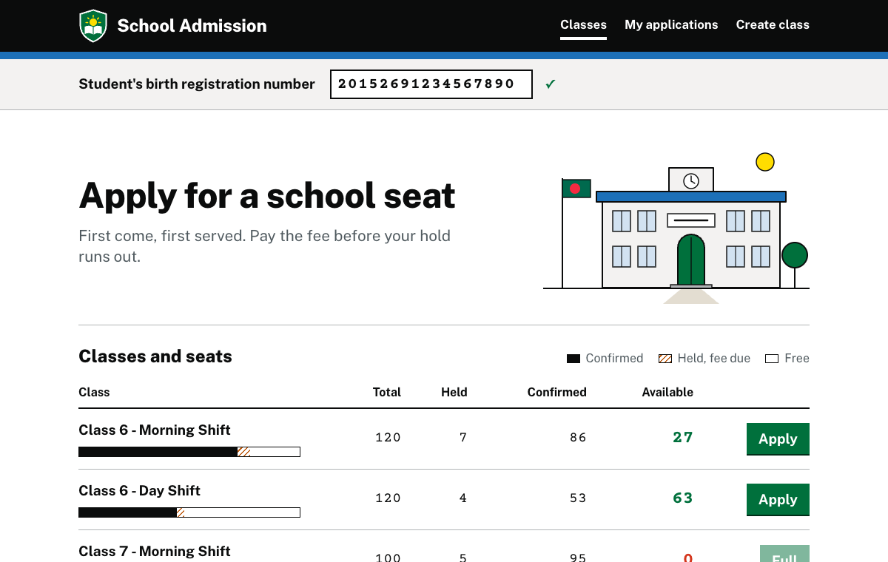
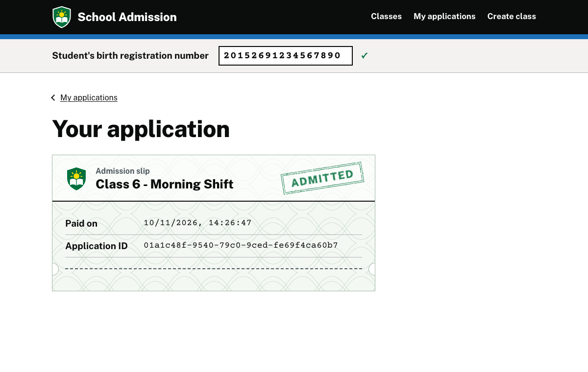
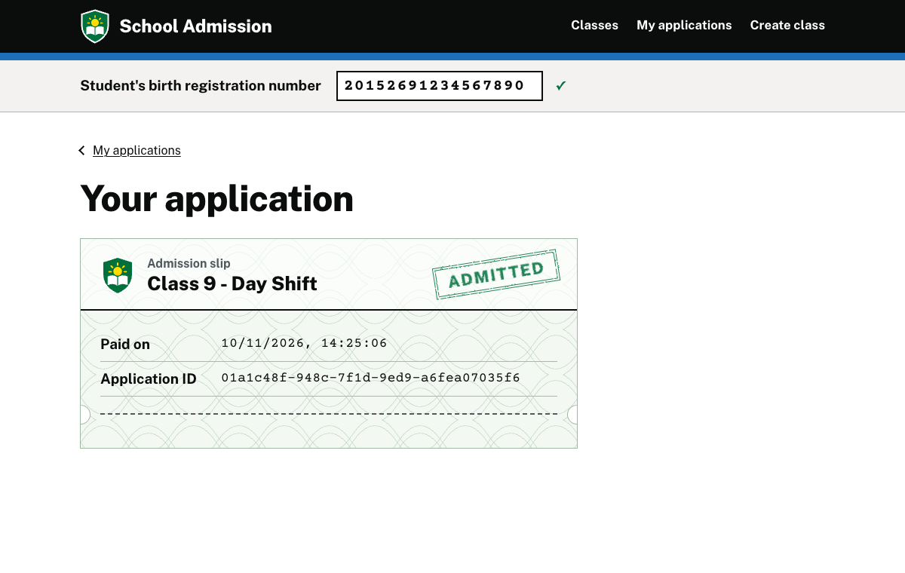
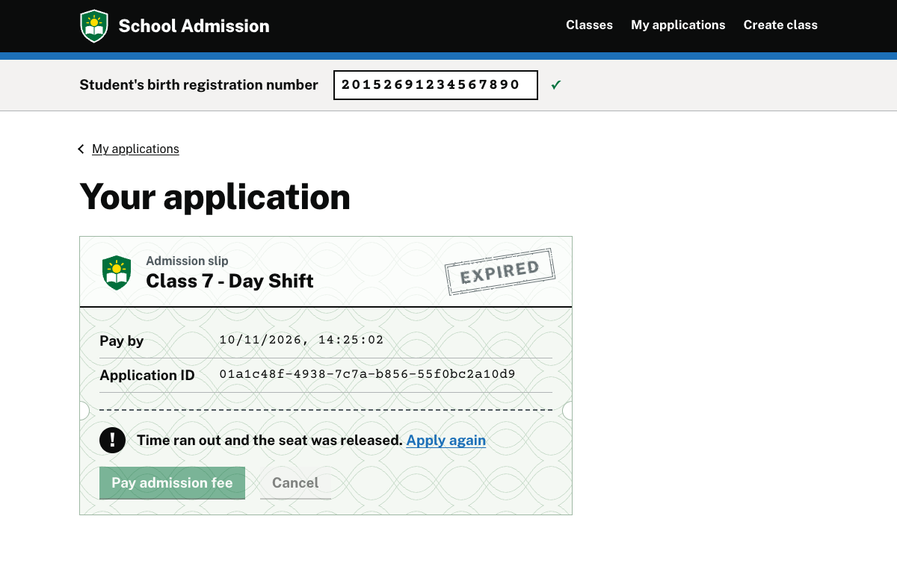
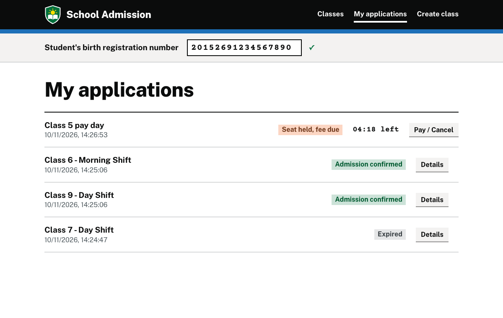
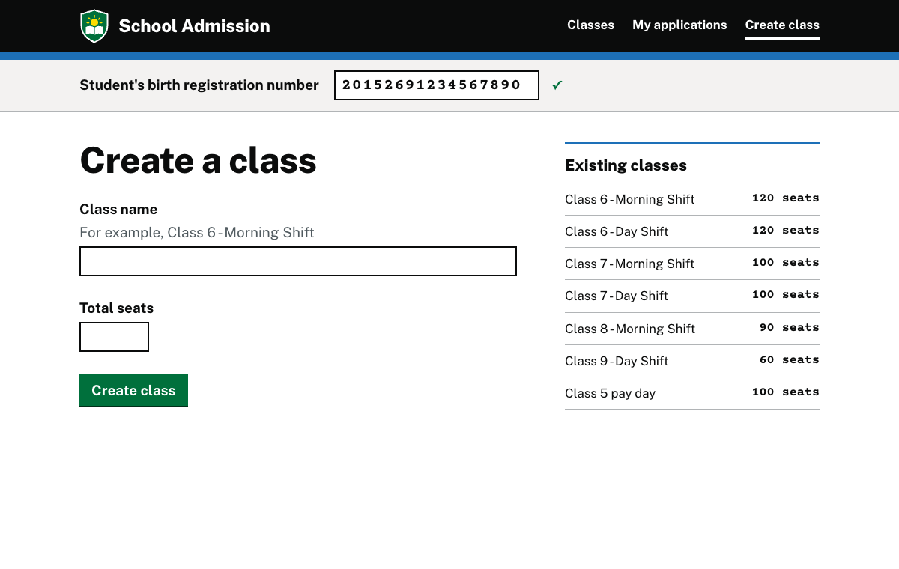
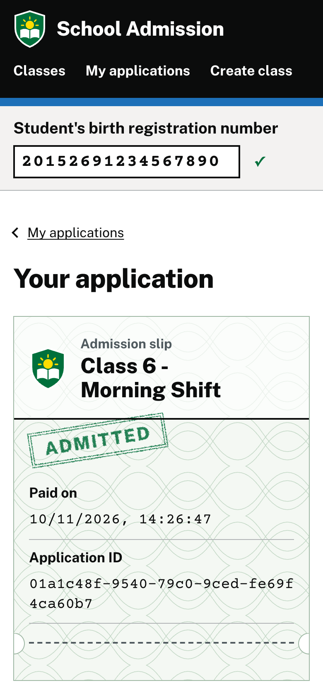

# School Admission System

First-come-first-served school admission. A parent applies and the seat is **held**; paying the
fee before the hold runs out **confirms** it. Unpaid holds expire on their own, and a seat is
never given out twice, even with two API instances on one database.


63-second walkthrough. Full-quality video: [docs/demo.mp4](docs/demo.mp4).

**Stack:** ASP.NET Core (.NET 10), EF Core, PostgreSQL 17, React 19 + TypeScript + Vite,
Docker Compose.

## Run

Needs only Docker.

```bash
docker compose up --build
```

UI: http://localhost:5173 · API: http://localhost:8080

Optional demo data (six classes, some paid, some held):

```bash
./scripts/seed-demo.sh
```

Holds last 600 seconds by default; set `HOLD_DURATION_SECONDS` to change it.

## Screenshots



| Application held | Fee paid | Expired |
|---|---|---|
|  |  |  |

| My applications | Create class | Phone |
|---|---|---|
|  |  |  |

## How it works

- **No overbooking:** every seat change locks its class row (`SELECT … FOR UPDATE`) in one
  short transaction. The lock lives in PostgreSQL, so it also holds across API instances.
- **Expiry without a job:** a hold counts only while `expires_at > now`, so seats free
  themselves at the exact moment, with no scheduler or API call.
- **One application per student per class:** checked under the lock and backed by a partial
  unique index.
- **UI:** the countdown flips to EXPIRED without a reload, seat counts refresh every 3 seconds,
  and the student id is kept in `localStorage`.

Decisions where the brief left room: [ASSUMPTIONS.md](ASSUMPTIONS.md). AI use:
[AI_USAGE.md](AI_USAGE.md).

## API

The student is identified by the `X-Student-Id` header (17 digits). Errors are
`application/problem+json` with a `code`.

| Endpoint | Purpose | Responses |
|----------|---------|-----------|
| `POST /classes` | Create a class | 201 · 400 |
| `GET /classes` | All classes with seat counts | 200 |
| `GET /classes/{classId}` | One class | 200 · 404 |
| `POST /classes/{classId}/holds` | Apply (hold a seat) | 201 · 400 · 404 · 409 `NO_SEATS_AVAILABLE` / `ALREADY_APPLIED` |
| `GET /holds/{holdId}` | Application status | 200 · 404 |
| `POST /holds/{holdId}/confirm` | Pay the fee (idempotent) | 200 · 403 · 409 `HOLD_EXPIRED` |
| `DELETE /holds/{holdId}` | Cancel | 204 · 403 · 409 |
| `GET /me/holds` | This student's applications | 200 |

## Tests

```bash
docker compose --profile test run --rm backend-tests
```

```bash
docker compose --profile test run --rm frontend-tests
```

39 backend tests against real PostgreSQL (domain rules, API contract, concurrency including
two API hosts on one database) and 18 frontend tests.

Two live API instances, 100 requests for 10 seats (expect `10 × 201`, `90 × 409`):

```bash
docker compose --profile multi up --build -d
```

```bash
./scripts/concurrency-demo.sh 10 100
```
